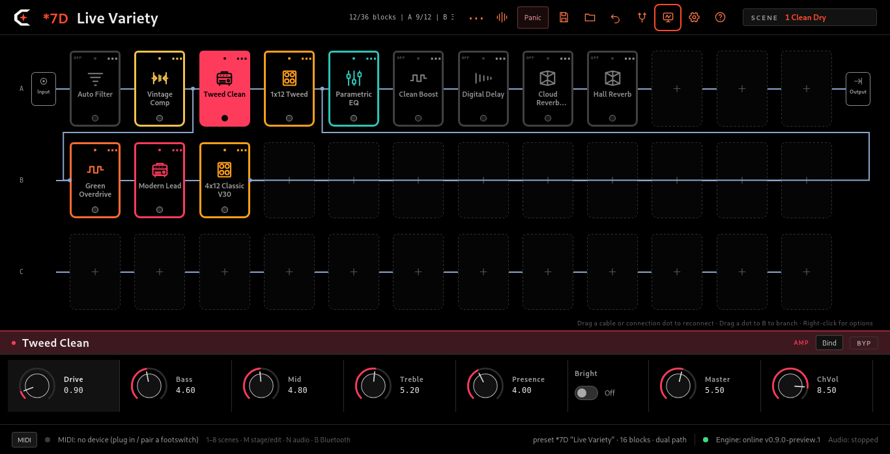
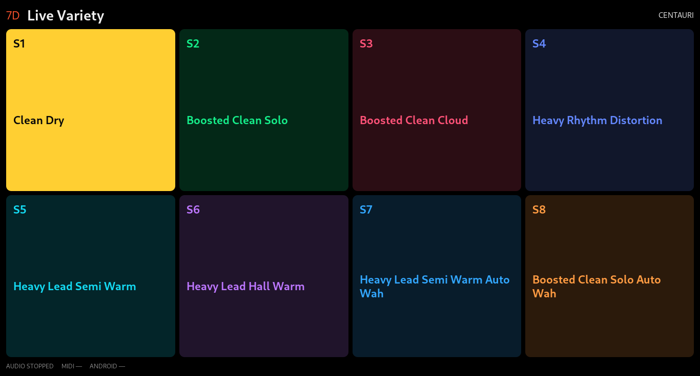

# CENTAURI

### Build your dream multi-FX rig.

Give a compatible laptop or mini PC a new life as a guitar processor—or keep
your everyday operating system and run CENTAURI as a standalone app.

[Official website](https://centauri.iceiy.com/) ·
[Downloads & installation](https://centauri.iceiy.com/downloads.html) ·
[Tutorials](https://centauri.iceiy.com/learn.html) ·
[Documentation](https://centauri.iceiy.com/docs.html) ·
[Facebook](https://www.facebook.com/centaurimultifx/)

## Get the public preview

| Edition | Your setup | Download |
| --- | --- | --- |
| Windows standalone | Windows 10/11 x86-64 + compatible audio interface | [Branded installer](https://github.com/starqiosk-cyber/centauri-releases/releases/download/v0.9.0-preview.1/CENTAURI-Setup-0.9.0-preview.1-windows-x86_64.exe) |
| Linux standalone | x86-64 Linux + GTK/WebKit runtime + audio interface | [Branded installer](https://github.com/starqiosk-cyber/centauri-releases/releases/download/v0.9.0-preview.1/CENTAURI-Setup-0.9.0-preview.1-linux-x86_64.run) |
| Android companion | Android 8+ + a CENTAURI OS processor | [Release APK](https://github.com/starqiosk-cyber/centauri-releases/releases/download/v0.9.0-preview.1/CENTAURI-Remote-0.9.0-preview.1-release.apk) |
| CENTAURI OS | Compatible x86-64 UEFI computer | **[Get CENTAURI OS → official website](https://centauri.iceiy.com/downloads.html#os)** |

Read the [detailed preview release notes](https://github.com/starqiosk-cyber/centauri-releases/releases/tag/v0.9.0-preview.1)
and [requirements/checksums](https://centauri.iceiy.com/downloads.html) before
installing. Standalone downloads use installers. OS images and corresponding
third-party sources are linked from the website.

## Make it your rig

* Three signal paths, 12 processing blocks per path, 36 total; two amps and two
  cabinets maximum. Built-in models, supported NAM captures and cabinet IRs.
* 32 protected factory presets, eight scenes each. **7D is the creator's Live
  Variety**, with clean, boosted, cloud, heavy rhythm/lead and auto-wah scenes.
  Create and rename Custom collections to make your own banks.
* Portrait pedals, Move/Copy across paths, compact controls, neon Stage mode and
  MIDI switching. In-app TONE3000 sign-in/catalog and optional AI-assisted preset
  drafting with audition before save.
* Android control with a full-screen preset chooser: four square buttons per row
  in portrait. The phone can relay supported online requests; the OS processor
  runs the guitar audio.
* One OS installer with **Headless / read-only Stage Display / Full GUI**.
  Choose the display load that suits the computer.

## Activation and updates

Start the trial shown in the activation screen, or enter a license code
immediately in Settings → License. One code covers one OS board and one
standalone computer at the same time. See [Safe/Permanent activation and transfer
rules](https://centauri.iceiy.com/licensing.html).

Standalone Settings → Updates checks this repository, verifies signed metadata
and the installer checksum, and asks before installation. Keep backups of your
presets; updating/uninstalling does not automatically remove personal sounds.

This is preview software. Windows audio was tested by the creator; broad OS
hardware, thermals and measured round-trip latency qualification are still in
progress. Read the release notes for the exact limits, including Windows
publisher signing and upgrade-cycle qualification.

## About this repository

This repository contains release binaries, checksums, signatures, screenshots
and user documentation. CENTAURI's original application source is private.
Bundled open-source projects and downloaded tone assets retain their respective
licenses. CENTAURI names/artwork are not granted an open-source license by this
release repository. See the included third-party notices and website source links.
